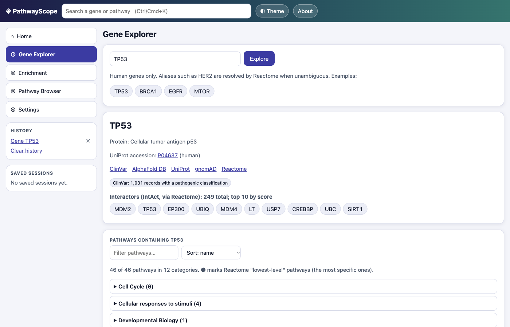
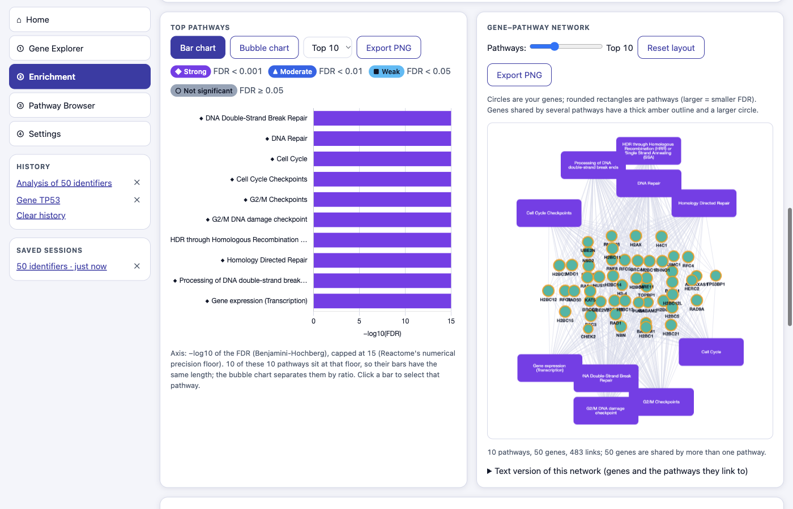
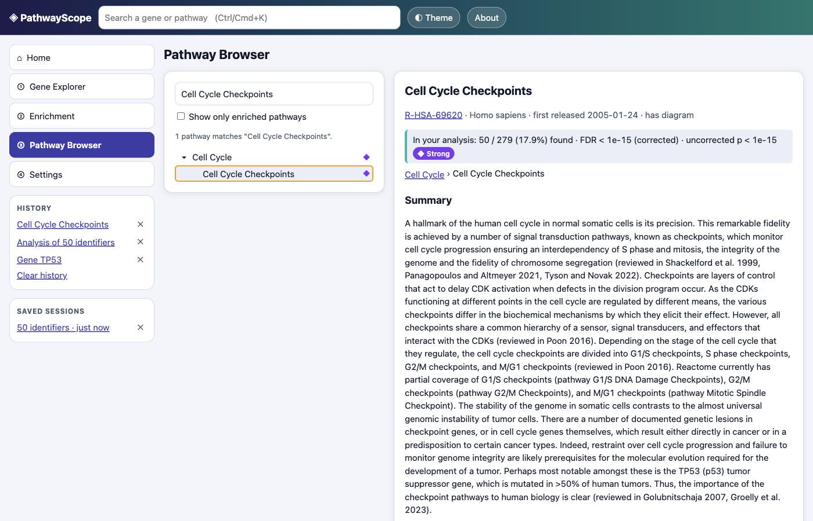
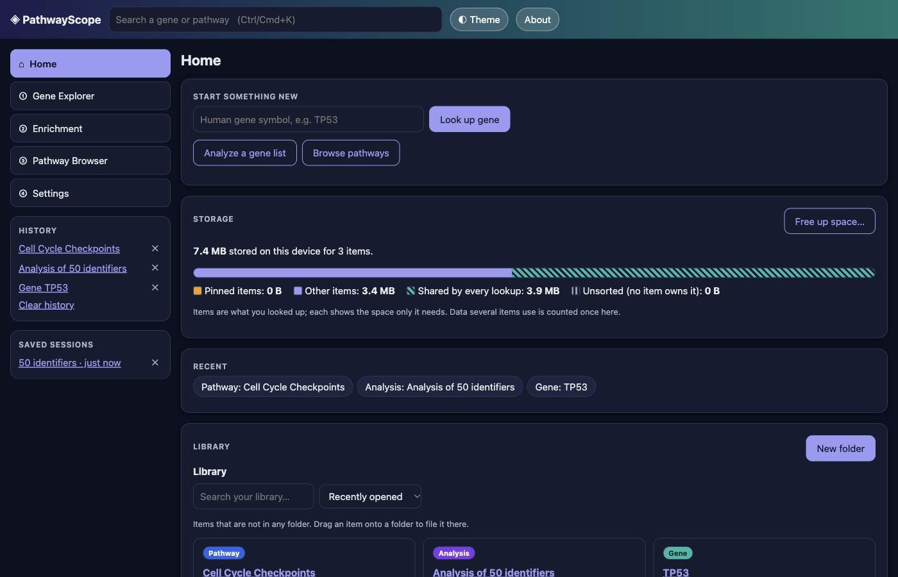

# PathwayScope

An interactive pathway explorer built on the [Reactome](https://reactome.org) knowledgebase. Look up a human gene to see every pathway it takes part in, paste a gene list to find which pathways are statistically enriched (with FDR-corrected p-values, charts and a gene-to-pathway network), and browse the full pathway hierarchy with diagrams. It ships three ways from one codebase: a desktop app (Windows, macOS, Linux), a website (GitHub Pages) and source you run with `npm`.

> **Educational and research-exploration use only. Not medical advice.** Pathway enrichment is hypothesis-generating, not proof.

- **Download:** [GitHub Releases](https://github.com/reeper316099/PathwayScope/releases) (installers are **unsigned**, see [Unsigned apps](#unsigned-apps-what-you-will-see-and-how-to-open-them))
- **Live demo:** https://reeper316099.github.io/PathwayScope/

## Screenshots

| Gene Explorer                                            | Enrichment                                              | Pathway Browser                                           |
| -------------------------------------------------------- | ------------------------------------------------------- | --------------------------------------------------------- |
|  |  |  |

**Home (desktop app)** is your library: everything you have looked up as one card each, with its size, folders and pinning.



More (dark mode, mobile web, the Settings page) are in [`docs/screenshots/`](docs/screenshots).

## Home: your library (desktop app)

The desktop app opens on **Home** (also reachable from the logo and the sidebar). Instead of a flat pile of cached files, it shows what _you_ did:

- **One card per thing you looked up** (a gene, a pathway, an analysis) with how much space it needs. Behind the scenes every cached response is tagged with the item that caused it, so "TP53" owns its gene search, protein name, ClinVar count, interactors and pathway list.
- **Shared data is shown separately** (for example the 3.9 MB pathway hierarchy every lookup uses), and deleting one item never removes data another item still needs.
- **Folders, nested and as many levels as you like.** Drag a card onto a folder, or use "Folders…". An item can be in several folders (the folder holds a shortcut, not a copy); deleting a folder never deletes its items.
- **Pin** an item to keep it: its stored data becomes a frozen snapshot that is served even when it is old or you are offline, and "Free up space" skips it.
- **Free up space** deletes every unpinned item at once; a storage bar shows pinned, other, shared and unsorted data.
- Deleting an item always asks first and tells you how much it frees and what stays.

The website has no Home page (its storage is small and temporary); it opens on Gene Explorer as before. **Settings → Stored data** remains the technical view of the raw cache.

## What has actually been tested (and what has not)

This table is updated only with things that were really run. "Built by CI, never launched by us" means the GitHub Actions build succeeded but nobody has actually started that installer on that operating system yet: please run the manual checklist below.

| Target                                     | Built locally                                | Run locally                                                                                                                                                                                                                  | Status                                |
| ------------------------------------------ | -------------------------------------------- | ---------------------------------------------------------------------------------------------------------------------------------------------------------------------------------------------------------------------------- | ------------------------------------- |
| Web app (Chrome)                           | yes                                          | yes: 46 end-to-end tests (15 need no live data, the rest use live Reactome)                                                                                                                                                  | **ran and passed**                    |
| macOS arm64 desktop app                    | yes (`.dmg`, ad-hoc signed)                  | yes: packaged app ran a gene search and a 50-gene enrichment                                                                                                                                                                 | **ran and passed**                    |
| Desktop app via `electron .` (macOS arm64) | n/a                                          | yes: 20 end-to-end tests (Home/library, security, IPC, persistence, offline)                                                                                                                                                 | **ran and passed**                    |
| macOS x64 `.dmg`                           | yes (cross-built on arm64; also built by CI) | no                                                                                                                                                                                                                           | **built by CI, never launched by us** |
| Windows x64 installer + portable           | built by CI (v0.1.0)                         | no                                                                                                                                                                                                                           | **built by CI, never launched by us** |
| Linux x64 AppImage + `.deb`                | built by CI (v0.1.0)                         | no                                                                                                                                                                                                                           | **built by CI, never launched by us** |
| GitHub Pages site (live)                   | n/a                                          | yes: real TP53 lookup and enrichment run on the deployed site                                                                                                                                                                | **ran and passed**                    |
| `pages.yml` workflow                       | n/a                                          | ran on GitHub (3 Nov 2026)                                                                                                                                                                                                   | **ran and passed**                    |
| `ci.yml` workflow                          | n/a                                          | ran on GitHub: lint, format, unit tests, web build and the hermetic end-to-end tests (the first run failed because Reactome's CDN rate-limited the runner during live tests; fixed by running only the hermetic tests in CI) | **ran and passed**                    |
| `release.yml` workflow                     | n/a                                          | ran on GitHub for tag v0.1.0: built on Ubuntu, Windows and macOS and published 6 installers plus `SHA256SUMS.txt`                                                                                                            | **ran and passed**                    |

## How it works

```
                    ┌────────────────────────── renderer (src/, vanilla JS) ──────────────────────────┐
 you ─ UI modules ─►│ core/reactomeContent.js   core/reactomeAnalysis.js   core/geneInfo.js           │
                    │                     └──────────────┬───────────────────┘                        │
                    │                         core/http.js  getJson(url, {method, body, ttl})         │
                    └──────────────┬─────────────────────┴───────────────────────┬────────────────────┘
                     in Electron   │                                             │   in a browser (web)
                                   ▼                                             ▼
        window.api.fetchJson ──IPC──► main process                       fetch() + throttle + retry
        (contextBridge, 9 functions)   host allowlist · https only        (needs the API to allow CORS)
                                       GET/POST only · size caps
                                       per-host rate limit · disk cache
                                                │
                                                ▼
        reactome.org (Content + Analysis Services) · rest.uniprot.org · eutils.ncbi.nlm.nih.gov
```

Enrichment flow: your gene list is parsed and cleaned (`geneList.js`) → POSTed as plain text to Reactome's Analysis Service (`/identifiers/projection`) → Reactome returns a **token** and per-pathway counts, p-values and FDR → the app pages through the results, loads the unmapped identifiers, and fetches "which of my genes are in this pathway" lazily. Tokens expire (about 7 days), so every saved session stores your gene list and the results, and re-runs itself if the token is gone.

## Data sources

All data comes straight from public APIs: no API keys, no paid services, no backend server of ours.

| Source                                                                     | Used for                                                                                               | Endpoint                                           | Accessed                                 |
| -------------------------------------------------------------------------- | ------------------------------------------------------------------------------------------------------ | -------------------------------------------------- | ---------------------------------------- |
| [Reactome](https://reactome.org) Content Service                           | gene search, pathways of a gene, pathway details, participants, hierarchy, interactors, diagrams (SVG) | `https://reactome.org/ContentService`              | 3-4 Nov 2026 (release 98, 2026-09-18)    |
| Reactome Analysis Service                                                  | over-representation analysis of a pasted gene list                                                     | `https://reactome.org/AnalysisService`             | 3-4 Nov 2026 (release 98)                |
| [UniProt](https://www.uniprot.org) REST                                    | protein name for the gene card                                                                         | `https://rest.uniprot.org`                         | 3-4 Nov 2026                             |
| [NCBI E-utilities](https://www.ncbi.nlm.nih.gov/books/NBK25497/) (ClinVar) | count of ClinVar records with a "pathogenic" classification                                            | `https://eutils.ncbi.nlm.nih.gov`                  | 3-4 Nov 2026                             |
| AlphaFold DB, gnomAD                                                       | **links only** (nothing is fetched from them)                                                          | `alphafold.ebi.ac.uk`, `gnomad.broadinstitute.org` | link-outs verified (HTTP 200) 3 Nov 2026 |

Every analysis shows the Reactome release it used. Endpoints, field names and response shapes were verified with real requests (not memory); what those checks found drove several design decisions (see [CHANGELOG](CHANGELOG.md)).

## What over-representation analysis is (and is not)

You give a list of genes (for example genes that changed in an experiment). For **each pathway**, Reactome asks: _if I drew this many genes at random from the background, how often would I see at least this many land in this pathway?_ That chance is the **p-value** (a hypergeometric test). Because hundreds of pathways are tested at once, some will look "significant" by luck, so the p-values are corrected: the **FDR (false discovery rate, Benjamini-Hochberg)** is the expected share of false hits among the pathways you call significant.

Limitations to keep in mind (the app states these in its About box and next to the results):

- **It generates hypotheses, it does not prove anything.** Enrichment says "these pathways contain more of your genes than chance predicts", not "these pathways are causal".
- **The background matters.** Reactome compares against all human Reactome entities (about 16,275 in release 98; this number is _derived_ from Reactome's own ratios, Reactome does not state it). A different background (for example only genes you measured) can change the answer.
- **FDR is computed over all pathways before any filter.** Hiding disease pathways or small pathways does not recompute it.
- **Reactome's numbers bottom out at p ~ 1e-16.** Many pathways tie at this floor and are shown as "< 1e-15"; their order relative to each other is not a meaningful ranking.
- **Counts are entities (proteins), not genes.** Paralogs that share a protein (for example many histone genes) can make "found" smaller than your gene count.
- **Pathway size matters.** Tiny pathways are easy to hit by chance; huge pathways are broad and less specific.
- **Identifier mapping is imperfect.** Aliases and lowercase symbols usually map (HER2 resolves to ERBB2), but some identifiers do not (in testing, the Entrez ID 7157 for TP53 was not recognised). Unmapped identifiers are always listed, never hidden, and results describe only the mapped part of your list.
- **Human pathways only.**
- **Educational use only. Not medical advice.** The ClinVar count is an orientation number, not a clinical statement.

### Significance thresholds (shown in the app legend)

| Label           | Rule on the FDR | Shape |
| --------------- | --------------- | ----- |
| Strong          | FDR < 0.001     | ◆     |
| Moderate        | FDR < 0.01      | ▲     |
| Weak            | FDR < 0.05      | ■     |
| Not significant | FDR ≥ 0.05      | ○     |

The table always shows both columns: `p-value (hypergeometric, uncorrected)` and `FDR (Benjamini-Hochberg)`; the labels use the FDR. The "ratio" column is _found ÷ total entities in the pathway_ (Reactome's own "entities ratio" is relative to the whole background, so we compute ours and label it).

## Run it

Requires Node.js 22.12 or newer.

```bash
npm ci
npm run dev               # web version at http://localhost:5173
npm run dev:electron      # desktop app against the dev server
npm run dev:electron:bg   # same, but the window does not steal focus
```

## Test

```bash
npm test                                   # unit tests (Vitest)
npm run test:coverage                      # with coverage of src/core
PW_CHANNEL=chrome npm run test:e2e         # end-to-end: web + Electron (uses your installed Chrome)
npm run test:e2e:web                       # all web tests (needs Playwright's Chromium: npx playwright install chromium)
npm run test:e2e:web:hermetic              # only the tests that need no live data (what CI runs)
npm run test:e2e:web:live                  # only the tests that call the live services
npm run lint && npx prettier --check .
```

Most end-to-end tests call the live public Reactome, UniProt and NCBI services. Those can rate-limit (HTTP 429, which a browser reports as a CORS error), so Playwright retries failed tests twice and reports retried tests as "flaky". If a run flakes, wait a minute and run again. Tests tagged `@hermetic` need no live data (the release-info call is answered from a saved real response); `PW_BLOCK_LIVE=1` makes the live services unreachable to prove it.

## Build installers

```bash
npm run dist       # installers for the OS you are on, into ./release
npm run dist:dir   # just the unpacked app (faster)
```

> **macOS tip:** if your project folder is inside iCloud Drive (for example `~/Desktop` or `~/Documents`), `codesign` fails with "resource fork, Finder information, or similar detritus not allowed", because iCloud adds attributes to folders. Build outside it:
> `npm run dist -- --config.directories.output="$HOME/pathwayscope-release"`

To run the end-to-end test against the packaged app:

```bash
PS_PACKAGED_APP="$HOME/pathwayscope-release/mac-arm64/PathwayScope.app/Contents/MacOS/PathwayScope" npm run test:e2e:packaged
```

## Releases and automation (GitHub Actions)

| Workflow      | When                                  | What it does                                                                                                                                                                           |
| ------------- | ------------------------------------- | -------------------------------------------------------------------------------------------------------------------------------------------------------------------------------------- |
| `ci.yml`      | every pull request and push to `main` | `npm ci`, lint, format check, unit tests, web build, and the **hermetic** web end-to-end tests (no live services)                                                                      |
| `pages.yml`   | push to `main`                        | builds the web version and deploys it to GitHub Pages                                                                                                                                  |
| `release.yml` | push of a tag like `v0.1.0`           | checks the tag matches `package.json`, creates a draft release, builds on Ubuntu, Windows and macOS runners, uploads the installers, adds `SHA256SUMS.txt`, then publishes the release |

Only official `actions/*` actions and the preinstalled GitHub CLI are used, pinned to the current major versions (checkout v7, setup-node v7, upload-artifact v7, configure-pages v6, upload-pages-artifact v5, deploy-pages v5; verified against the GitHub API when the workflows were written). The release job uses the built-in `GITHUB_TOKEN` with `contents: write` only for the jobs that upload.

Release artifacts: `PathwayScope-Setup-<version>-win-x64.exe`, `PathwayScope-Portable-<version>-win-x64.exe`, `PathwayScope-<version>-mac-arm64.dmg`, `PathwayScope-<version>-mac-x64.dmg`, `PathwayScope-<version>-linux-x86_64.AppImage`, `PathwayScope-<version>-linux-amd64.deb`, and `SHA256SUMS.txt`.

### Cutting a release

There is nothing to switch on: the workflow files are live as soon as they are on `main`. The release workflow runs **only when you push a tag that starts with `v`**.

1. Make sure `main` is green (the **CI** and **Deploy web version to GitHub Pages** runs on the Actions tab).
2. Set the version: `package.json` `"version"` must match the tag without the `v` (tag `v0.1.0` needs version `0.1.0`), otherwise the workflow stops on purpose. Add the notes to `CHANGELOG.md`.
3. Commit and push to `main`.
4. Create and push the tag:
   ```bash
   git tag -a v0.1.0 -m "PathwayScope 0.1.0"
   git push origin v0.1.0
   ```
5. Watch it: Actions tab → **Release**, or `gh run watch`. It creates a draft release, builds on Ubuntu, Windows and macOS (about 10-20 minutes), uploads the installers, adds `SHA256SUMS.txt`, then publishes the release.
6. Find the installers on the repository's **Releases** page (or `gh release view v0.1.0`).
7. If a build fails, fix it, then delete the tag and the draft release and tag again:
   ```bash
   gh release delete v0.1.0 --yes
   git push --delete origin v0.1.0
   git tag -d v0.1.0
   ```

## Unsigned apps: what you will see and how to open them

The installers are **not code-signed and not notarized** (that needs paid developer certificates). Signing, notarization and auto-update are on the stretch list. The app is safe to inspect: the source is in this repository, and `SHA256SUMS.txt` lets you check your download.

**Windows (SmartScreen):** you will likely see "Windows protected your PC / unknown publisher". Click **More info**, then **Run anyway**.

**macOS (Gatekeeper):** the app has a valid _ad-hoc_ signature but no Apple Developer ID, so macOS will say it cannot verify the developer. Typical ways to open it:

1. Open the `.dmg`, drag PathwayScope to Applications, try to open it once.
2. Go to **System Settings → Privacy & Security**, scroll to the message about PathwayScope, click **Open Anyway** (on older macOS: right-click the app, choose **Open**, then **Open**).
3. Or, in Terminal: `xattr -dr com.apple.quarantine /Applications/PathwayScope.app`

(The exact wording depends on your macOS version. These steps were not tested on a downloaded copy.)

**Linux:** make the AppImage executable (`chmod +x PathwayScope-*.AppImage`) and run it, or install the `.deb` with `sudo apt install ./PathwayScope-*.deb`. On Ubuntu 22.04 and newer the AppImage may need `sudo apt install libfuse2`. On Ubuntu 24.04 and newer, AppArmor can block Electron's sandbox for AppImages; the `.deb` sets up the sandbox helper itself. (Linux builds are untested locally.)

## Manual checklist after a release

Things automated tests cannot do (native dialogs, real keystrokes, other operating systems). Tick them off on each OS you have:

1. Download an installer from the Releases page and check it against `SHA256SUMS.txt` (`shasum -a 256 <file>` on a Mac).
2. Open it (see the unsigned-app steps above), launch the app, and confirm it opens on **Home**.
3. Look up **TP53** in Gene Explorer, run an enrichment analysis with a pasted gene list, open a pathway with a diagram.
4. On Home: see the TP53 card with a size, **Pin** it, create a **folder**, drag the card into it, then delete a second item and check the numbers.
5. **File → Save Session** and **Open Session** (native dialogs), and **File → Show Data Folder**.
6. Press Cmd/Ctrl+K, Cmd/Ctrl+Shift+H, Cmd/Ctrl+1 to 4 and Cmd/Ctrl+D.
7. Turn off your network and check that a cached gene and a saved analysis still open with the "Offline" banner.

## Security notes

- Electron windows use `contextIsolation: true`, `nodeIntegration: false`, `sandbox: true`, a strict Content-Security-Policy (`default-src 'none'`, scripts and styles only from the app itself, no `eval`, no inline scripts), no remote code, denied permission requests, blocked navigation and blocked new windows.
- The page can call exactly nine functions (`fetchJson`, `saveFile`, `openExternal`, `getAppInfo`, `listCache`, `deleteCacheEntry`, `removeCacheOwner`, `setCachePinned`, `onMenuAction`). All arguments are validated again in the main process.
- Network access: the main process only talks to `reactome.org`, `rest.uniprot.org` and `eutils.ncbi.nlm.nih.gov` over https, GET and POST only (POST only to the Analysis Service), with size caps, timeouts, rate limiting and redirect re-checking. Links open in your browser only for an allowlist of hosts.
- Reactome's diagrams are SVG; they are sanitized (DOMPurify plus extra rules: no scripts, no foreign content, only embedded PNG data URLs) before being inlined.
- Your data stays on your device (see **Settings → Stored data** in the app, or File → Manage Stored Data). Gene symbols and lists you enter are sent to the public Reactome, UniProt and NCBI services to look them up, and nowhere else.

## Data attribution and licenses

PathwayScope's own code is MIT-licensed ([LICENSE](LICENSE)). The data it displays belongs to its providers:

- **Reactome**: released under [CC0 1.0](https://creativecommons.org/publicdomain/zero/1.0/) (confirmed on https://reactome.org/license on 3 Nov 2026; attribution is encouraged, not required). Please cite: Ragueneau E, Gong C, Sinquin P, et al. **The Reactome Knowledgebase 2026.** _Nucleic Acids Res._ 2026;54(D1):D673-D681 (published online Nov 2025). doi:[10.1093/nar/gkaf1223](https://doi.org/10.1093/nar/gkaf1223). Earlier version: Milacic M, et al. _The Reactome Pathway Knowledgebase 2024._ _Nucleic Acids Res._ 2024;52(D1):D672-D678. doi:[10.1093/nar/gkad1025](https://doi.org/10.1093/nar/gkad1025). Reactome's guidance for citing pathways, diagrams and downloads is at https://reactome.org/cite; diagrams shown in the app carry Reactome's own watermark.
- **UniProt**: all copyrightable parts of its databases are under [CC BY 4.0](https://creativecommons.org/licenses/by/4.0/) (confirmed on https://www.uniprot.org/help/license on 3 Nov 2026). Please cite: The UniProt Consortium. **UniProt: the Universal Protein Knowledgebase in 2025.** _Nucleic Acids Res._ 2025;53(D1):D609-D617. doi:[10.1093/nar/gkae1010](https://doi.org/10.1093/nar/gkae1010).
- **NCBI / ClinVar**: NCBI's policies (https://www.ncbi.nlm.nih.gov/home/about/policies/, read on 3 Nov 2026) say information created by or for the US government is public domain and ask for acknowledgment; some contributed material may carry other terms. ClinVar's own data-use page was not reachable for automated checking (it sits behind a CAPTCHA), so **please read it yourself before redistributing ClinVar data**. Cite: Landrum MJ, et al. **ClinVar: improving access to variant interpretations and supporting evidence.** _Nucleic Acids Res._ 2018;46(D1):D1062-D1067. doi:[10.1093/nar/gkx1153](https://doi.org/10.1093/nar/gkx1153) (publication details checked against Crossref; ClinVar's recommended citation was not checked on its own page).
- **AlphaFold DB** and **gnomAD**: linked only, no data is used or stored. See their sites for terms.

Third-party software bundled into the app (licenses read from the installed packages): [Electron](https://www.electronjs.org) (MIT), [Cytoscape.js](https://js.cytoscape.org) (MIT; Franz M, et al. _Cytoscape.js 2023 update._ _Bioinformatics_ 2023;39(1). doi:[10.1093/bioinformatics/btad031](https://doi.org/10.1093/bioinformatics/btad031)), [Chart.js](https://www.chartjs.org) (MIT), [DOMPurify](https://github.com/cure53/DOMPurify) (MPL-2.0 OR Apache-2.0), [Vite](https://vite.dev) (MIT, build tool). The app icon and name are original; this project is not affiliated with or endorsed by Reactome, and does not use Reactome's logo or branding.

## Roadmap: five stretch features, ranked by impact versus effort

| #   | Feature                                                                                                                    | Impact                                | Effort      | Notes                                                                                                     |
| --- | -------------------------------------------------------------------------------------------------------------------------- | ------------------------------------- | ----------- | --------------------------------------------------------------------------------------------------------- |
| 1   | **Share gene links with VariantScope** (open `#/explorer/<gene>` deep links, and link out from VariantScope into this app) | medium                                | **low**     | The router already supports `#/explorer/<gene>`; this is mostly a link contract between the two projects. |
| 2   | **Compare two gene lists side by side** (shared and unique enriched pathways)                                              | **high**                              | medium      | All the data shapes already exist; needs a second session slot and an overlap view.                       |
| 3   | **Code signing, notarization and auto-update** (`electron-updater`)                                                        | **high** (removes the scary warnings) | medium-high | Needs an Apple Developer account and a Windows signing certificate; CI already builds everything.         |
| 4   | **Expression fold-changes (GSEA-style)**: upload a gene + value table                                                      | **high**                              | high        | Reactome's Analysis Service also accepts expression data; needs a new input format and result view.       |
| 5   | **Species switching** (mouse, rat, ... via Reactome projection)                                                            | medium                                | medium      | The API already supports it; the UI and the human-only wording need to change.                            |

Not ranked: pathway-level ClinVar variant burden (high effort: many NCBI requests and careful interpretation).

## What I learned

> **TODO (for you): write this section in your own words before publishing.** Prompts: What surprised you about the data (aliases, unmapped genes, ties at the p-value floor)? What did testing against live services teach you (rate limits, CORS, tokens that expire)? What would you do differently? Which part can you explain best in an interview?
