# PathwayScope architecture

This document explains how PathwayScope is put together and why. It describes the code as it is in version 0.2.0. For usage see the [README](../README.md); for release history see the [CHANGELOG](../CHANGELOG.md).

## 1. The big picture

PathwayScope is a pathway explorer for [Reactome](https://reactome.org). It is **one codebase that ships in two forms**:

| Form                | Built with                | Network access                                  | Extras                                                         |
| ------------------- | ------------------------- | ----------------------------------------------- | -------------------------------------------------------------- |
| Website (GitHub Pages) | `vite build --mode web`      | The browser calls the three APIs directly (CORS) | None. Opens on Gene Explorer. No Home page.                    |
| Desktop app (Electron) | `vite build --mode electron` | Only the Electron **main process** calls the APIs | Disk cache, Home library, pinning, folders, native menus/dialogs |

There is no backend, no account and no API key. Everything the app knows comes from three public services:

- **Reactome** (`reactome.org`): content service, analysis service, diagram exporter, pathway hierarchy.
- **UniProt** (`rest.uniprot.org`): gene and protein records.
- **NCBI E-utilities** (`eutils.ncbi.nlm.nih.gov`): gene summaries and a count of ClinVar records classified pathogenic.

The UI is vanilla JavaScript (ES modules) bundled with Vite. There is no UI framework.

```
┌───────────────────────────── Renderer (sandboxed web page) ─────────────────────────────┐
│  src/ui/*   views, dialogs, DOM helper        src/core/*   pure logic + the one adapter │
│        │                                              │                                  │
│        └────────────── getJson() (src/core/http.js) ──┘                                  │
│                          │                                                               │
│            web build: fetch()          Electron build: window.api.fetchJson()            │
└──────────────────────────┼───────────────────────────────┬──────────────────────────────┘
                           │                               │ contextBridge (preload.cjs)
                    public APIs (CORS)                     ▼
                                          ┌──────────── Main process (electron/*) ────────────┐
                                          │ validate → allowlist → rate limit → disk cache →  │
                                          │ https fetch → size cap → store (with owners)      │
                                          └──────────────────────┬────────────────────────────┘
                                                                 ▼
                                                  Reactome / UniProt / NCBI (https only)
```

## 2. Repository layout

| Path                    | What lives there                                                                                       |
| ----------------------- | ------------------------------------------------------------------------------------------------------ |
| `src/core/`             | Pure logic with no DOM access: API clients, statistics, parsing, export, the library model. Unit-tested. |
| `src/ui/`               | Views and widgets. Each view is created with `createXxxView(root, ctx)`.                                |
| `src/main.js`           | Boot: mode routing (hash router), shared `ctx`, menu actions, theme.                                    |
| `src/index.html`        | The single page. Tabs, view containers, hidden desktop-only items.                                      |
| `src/styles/`           | `tokens.css` (design variables), `base.css`, `components.css`. No inline styles anywhere.               |
| `electron/`             | Main process: window, menu, IPC, validation, allowlist, rate limiting, disk cache, window state.        |
| `tests/unit/`           | Vitest. One file per core module plus the Electron validators and cache.                                |
| `tests/e2e/`            | Playwright: `web/` (browser), `electron/` (real app), `packaged/` (installed build).                    |
| `tests/fixtures/`       | Real API responses recorded once, used by hermetic tests.                                               |
| `scripts/`, `build/`    | Dev launcher, icon generation, the ad-hoc signing `afterPack` hook, installer resources.                |
| `.github/workflows/`    | `ci.yml`, `pages.yml`, `release.yml`.                                                                   |
| `scratch/`              | Throwaway probe scripts used while verifying APIs. Not part of the product.                             |

## 3. The renderer

### 3.1 Modes and routing

The app has up to four views, chosen by the URL hash (`#/home`, `#/gene`, `#/enrichment`, `#/browser`, `#/settings`). `src/main.js` builds the mode list at boot: `home` is included only when `isElectron()` is true, and the default mode is the first entry. That is how the desktop app opens on Home while the website opens on Gene Explorer. Home-related elements in `index.html` carry `data-desktop-only hidden` and are revealed at boot on desktop.

Views never import each other. They talk through a shared `ctx` object created in `main.js`, which offers navigation (`go`), opening a pathway or an analysis (`openPathway`, `openAnalysis`), the library's owner ids (`contextOwners`), and dialogs.

### 3.2 The three modes

- **Gene Explorer** (`geneExplorer.js`, `geneCard.js`): resolves a symbol or alias (HER2 → ERBB2) through Reactome search, shows the gene card (UniProt, NCBI summary, ClinVar count, interactors), and lists the pathways the gene participates in, grouped by top-level category.
- **Enrichment Analysis** (`enrichmentView.js`, `listInput.js`, `enrichmentTable.js`, `enrichmentChart.js`): submits a gene list to the Analysis Service and shows results with **raw p-value and FDR kept separate**, the number mapped and unmapped, and the background used. Results can be overlaid on a pathway diagram.
- **Pathway Browser** (`browserView.js`, `pathwayTree.js`): the full hierarchy as a navigable tree.

Shared by all three: `pathwayDetail.js` (drawer with summary, participants, references), `diagramView.js` (sanitized SVG diagram), `networkView.js` (Cytoscape interaction network), `selection.js`, `search.js`.

### 3.3 DOM and styling rules

- All elements are built with the `h()` helper in `dom.js`. It never uses `innerHTML` for untrusted text and applies `style` through the CSSOM (`el.style.x = …`), because the CSP forbids inline style attributes.
- Cytoscape normally injects a `<style>` tag, which the CSP blocks. `index.html` contains a placeholder element with the id Cytoscape looks for, and its one rule lives in `components.css`.
- Light/dark theme is handled in `theme.js` with CSS variables from `tokens.css`.

### 3.4 State

`state.js` holds the small amount of shared state: the current analysis session, the library store, history. Persistence in the renderer is deliberately minimal:

| Key           | Where          | What                                                            |
| ------------- | -------------- | -------------------------------------------------------------- |
| `ps:history`  | `localStorage` | Recent lookups (also imported once into the library on desktop) |
| `ps:library`  | `localStorage` | The Home library: items, folders, memberships                   |
| `ps:sessions:*` | `localStorage` (`sessionStore.js`) | Saved analysis sessions (export/import as JSON files) |

## 4. The one network adapter

**Nothing in the app calls `fetch` except `src/core/http.js`.** Every API client (`reactomeContent.js`, `reactomeAnalysis.js`, `geneInfo.js`, `hierarchy.js`) goes through `getJson()` / `getJsonWithMeta()`. This single choke point is what makes the rest of the design work:

- **Two transports behind one interface.** In Electron it calls `window.api.fetchJson`. In a browser it calls `fetch()` with a per-host throttle and one retry for GET requests.
- **Typed errors.** `HttpError.kind` is one of `network | timeout | http | blocked | aborted`, so the UI can show a useful message instead of a stack trace.
- **In-memory cache** (`cache.js`) with TTLs: content 7 days, analyses 24 hours, release info 24 hours. It can fall back to a stale entry when the network fails, and tells the UI so (the offline banner listens through `onRequestMeta`).
- **Ownership tags.** Callers pass `owners: ['gene:TP53']` so the desktop disk cache knows which library item caused a response (see section 6).

Reactome sits behind Cloudflare. When it rate-limits (HTTP 429) a browser reports a CORS failure, not a status code. The browser transport therefore throttles and retries, and the error message says rate limiting is possible.

## 5. The Electron main process

### 5.1 Process and window security

The window is created with `contextIsolation: true`, `nodeIntegration: false`, `sandbox: true`, `webSecurity: true`, `webviewTag: false`. All permission requests are denied. `setWindowOpenHandler` and `will-navigate` stop the page from opening windows or navigating away; external links go through `openExternal`, which only opens hosts in `LINK_HOSTS`.

The production page carries a strict CSP `<meta>` injected by a Vite plugin: `default-src 'none'`, `script-src 'self'`, `style-src 'self'`, `connect-src 'self'` (the desktop renderer talks to **nobody**; only the main process does). The web build adds the three API hosts to `connect-src`. Dev mode applies a looser header because Vite's hot reload needs it.

### 5.2 The preload bridge

`preload.cjs` is CommonJS because sandboxed preloads cannot be ES modules. It exposes exactly **nine functions** on `window.api`, and a test pins that list so it cannot grow by accident:

| Function                          | Purpose                                                              |
| --------------------------------- | -------------------------------------------------------------------- |
| `fetchJson(url, options)`         | The only network path. Options are whitelisted field by field.        |
| `saveFile(request)`               | Native "Save as" dialog, then the main process writes the file.       |
| `openExternal(url)`               | Open an allowlisted https link in the system browser.                 |
| `getAppInfo()`                    | Name, version, platform for the About dialog.                         |
| `listCache()`                     | Cached entries with owners, sizes, and which owners are pinned.       |
| `deleteCacheEntry(key)`           | Delete one entry, or everything with the key `all`.                   |
| `removeCacheOwner(owner)`         | Remove one library item's data (shared data stays).                   |
| `setCachePinned(owner, pinned)`   | Pin or unpin an item's data.                                          |
| `onMenuAction(callback)`          | One-way subscription to native menu actions.                          |

The preload checks argument types early; the main process re-validates everything anyway, because the renderer is never trusted.

### 5.3 The request pipeline

For each `fetchJson` call, `ipc.js` → `validate.js` → `remoteFetch.js` do the following in order:

1. **Validate** (`validate.js`): https only, no credentials in the URL, no custom port, bounded URL length, host in `FETCH_HOSTS`, method GET or POST only, only `accept` and `content-type` headers, POST only to the Analysis Service prefix with a body under 1 MB, timeout clamped, owners filtered to the `gene|pathway|analysis` pattern (max 8).
2. **Cache lookup** (`diskCache.js`): the key is a SHA-256 of method + URL + a hash of the POST body. A fresh hit is returned immediately. A **pinned** entry is returned regardless of age.
3. **Rate limit**: a minimum gap per host (`MIN_INTERVAL_MS`: Reactome 150 ms, UniProt 100 ms, NCBI 350 ms, which respects NCBI's three requests per second without a key).
4. **Fetch** with a timeout. Redirects are followed manually and each hop is re-checked against the allowlist. Response size is capped at 25 MB.
5. **Store** the body and its metadata (including owners) to disk.
6. **Fallback**: if the network fails and an older copy exists, serve it marked as stale rather than failing.

Every limit is in one file, `allowlist.js`, so it can be audited at a glance.

### 5.4 The disk cache

`DiskCache` stores one JSON file per request in `<userData>/pathwayscope-data-cache/`, plus a small metadata file next to each body (label, kind, size, timestamps, owners). Pins are kept in `pins.state` in the same folder. "Delete everything" clears entries but intentionally leaves `pins.state` alone, so the renderer unpins explicitly first.

Writes merge owners: if two items cause the same response, both are recorded, and the file is deleted only when the last owner is removed (`removeOwner` returns `{ removed, freedBytes }`).

## 6. The library (Home)

The Home page turns a pile of cache files into things a person recognizes: genes, pathways and analyses. It is desktop-only and lives in `src/core/library.js` (pure model) and `src/ui/homeView.js` (view).

### 6.1 Ownership model

Every cached response carries a set of **owners**:

- `gene:TP53`, `pathway:R-HSA-69541`, `analysis:<session id>`.
- Kind `shared` (pathway hierarchy, release info) is needed by everything and is **never** deleted by removing an item.
- A response with no known owner is **unsorted** (for example data cached before the library existed).

Rules that follow from this:

- Deleting an item removes only the entries whose owner set becomes empty. If a pathway's data is also used by another gene, it stays.
- Aliases resolve to the canonical item, so HER2 and ERBB2 are one card.
- Because browsers have no async context to tell "who asked", call sites pass `owners` explicitly down through the API clients to `getJson`.

### 6.2 What the library stores

`library.js` is a plain data structure with pure functions (no I/O), persisted by `createLibraryStore` to `localStorage` under `ps:library`:

- **Items**: `{ id, type, key, label, aliases }`, with `id` equal to the owner id.
- **Folders**: nested up to 8 levels deep, up to 500 total, names unique among siblings (case-insensitive), cycle checks on move. Folders hold **references** to items, so an item can be in several folders. Deleting a folder never deletes its items.
- **Pins**: a set of owner ids, mirrored to the main process so the disk cache honors them.
- **Sessions**: `syncSessions` adds an item for each saved analysis session and never overwrites existing items. `importHistory` converts old history entries once.
- `parseLibrary` validates anything read back from storage, so corrupt data degrades to an empty library instead of a crash.

### 6.3 Storage accounting

`computeUsage`, `folderUsage` and `storageBreakdown` split bytes into **pinned / items / shared / unsorted** with no double counting. A folder's size is the de-duplicated union of its items' entries plus session bytes, so a shared response is counted once.

### 6.4 Pinning ("keep")

A pinned item's entries are served from cache **regardless of age**, which makes it a frozen snapshot that works with the network cut. "Free up space" deletes every unpinned item and skips pinned ones. Deleting an item always asks first and states what it frees and what stays.

## 7. Data flow example

Looking up **TP53** in Gene Explorer on desktop:

1. `geneExplorer.js` calls the Reactome client with `owners: ['gene:TP53']`.
2. `getJson` → `window.api.fetchJson(url, { owners, label, kind, cacheTtlSeconds })`.
3. The main process validates, misses the cache, waits for the Reactome rate-limit slot, fetches, and writes `<hash>.json` with `owners: ['gene:TP53']`.
4. Opening a pathway from that gene adds `pathway:R-HSA-…` as a second owner on the shared responses it requests.
5. `touchLibrary` records the item in the library so it appears on Home.
6. On Home, `listCache()` returns every entry with its owners; `computeUsage` groups them into per-item sizes; the storage bar and cards render from that.
7. Deleting TP53 calls `removeCacheOwner('gene:TP53')`; only entries left with no owner are removed from disk.

## 8. Statistics and honesty rules

Enrichment results must never mislead, so `stats.js` and the table keep these separate and visible: raw p-value, FDR (Benjamini–Hochberg as returned by Reactome), identifiers submitted, identifiers mapped, identifiers not found, and the background (the whole Reactome gene set unless stated). Results are never described as medical findings; the app is for education and research exploration.

## 9. Testing strategy

| Layer                 | Tool       | What it covers                                                                                             | Needs network |
| --------------------- | ---------- | ---------------------------------------------------------------------------------------------------------- | ------------- |
| Unit (`tests/unit`)   | Vitest     | Core logic, validators, disk cache, library model (282 tests)                                              | No            |
| Web hermetic          | Playwright | Website behavior with live hosts blocked (`@hermetic`, `PW_BLOCK_LIVE=1`), using recorded fixtures         | No            |
| Web live              | Playwright | Real Reactome/UniProt/NCBI responses                                                                       | Yes           |
| Electron              | Playwright | The real app: Home, owner tagging, pins, folders, restart persistence. Checks **files on disk** after actions | Reactome for some |
| Packaged              | Playwright | The installed macOS build launched via `PS_PACKAGED_APP`                                                   | Some          |

Notes:

- Fixtures in `tests/fixtures/` are real responses recorded by scripts in `scratch/`, never hand-written.
- CI runs only the hermetic tests, because Reactome rate-limits shared runner IPs and made live tests flaky. Run live and Electron tests locally, and not back to back.
- `PW_CHANNEL=chrome` runs web tests in local Chrome.

## 10. Build, CI and release

- `npm run dev` runs the web dev server; `npm run dev:electron` runs the desktop app against it (`:bg` keeps it from stealing focus).
- `npm run dist` builds installers with electron-builder: macOS (arm64 and x64), Windows (installer and portable), Linux (AppImage and `.deb`). A `afterPack` hook ad-hoc signs the macOS app; the installers are otherwise **unsigned**, which the README explains to users.
- **ci.yml** (pull requests and pushes): install, lint, format check, unit tests, build, hermetic browser tests.
- **pages.yml** (push to `main`): builds the web mode and deploys it to GitHub Pages.
- **release.yml** (push of a tag like `v0.2.0`): checks the tag equals `package.json`'s version, creates a draft release, builds installers on Ubuntu, Windows and macOS, uploads them, adds `SHA256SUMS.txt`, then publishes. Only official `actions/*` actions are used, with minimal token permissions.

Build outside iCloud-synced folders: iCloud adds extended attributes that break ad-hoc signing.

## 11. Design decisions and trade-offs

- **One adapter, two transports.** Keeping all networking in `http.js` lets the same UI code run in a browser and in Electron, and makes the security story simple to audit.
- **Renderer has no network in Electron.** The CSP says `connect-src 'self'`. A compromised page can only ask the main process, which enforces the allowlist.
- **Owners instead of per-feature caches.** Tagging responses with the item that caused them is what lets "delete TP53" free exactly TP53's space. The cost is that callers must pass `owners` explicitly.
- **Folders hold references.** Multi-folder membership and safe folder deletion fall out of this for free.
- **Pure model, thin view.** `library.js` has no DOM or storage access, so loops, depth limits, name clashes and corrupt data are all unit-tested.
- **No keys, no backend.** Cheaper and safer, but the app depends on public rate limits, which is why throttling, retries and stale fallback exist.

## 12. Known limits

- Windows, Linux and macOS x64 installers are built by CI but have not been launched by a person.
- Native Save/Open dialogs and real keystroke shortcuts are on the manual checklist in the README.
- The website has no Home page, disk cache or pinning.
- Data comes from live public APIs: results change when Reactome releases a new version, and a pinned snapshot is intentionally frozen.
- ClinVar's own data-use terms have not been verified (the site is behind a CAPTCHA). The app shows only a count, labeled as an orientation number, not a clinical statement.


## Diagram

```mermaid
%% Generated by https://gitdiagram.com/reeper316099/pathwayscope
flowchart TD

subgraph group_renderer["Explorer UI"]
  node_app["App entry<br/>[main.js]"]
  node_gene_view["Gene explorer<br/>[geneExplorer.js]"]
  node_enrichment_view["Enrichment view<br/>[enrichmentView.js]"]
  node_gene_list["Gene list input<br/>[listInput.js]"]
  node_pathway_view["Pathway detail<br/>[pathwayDetail.js]"]
  node_pathway_browser["Pathway browser<br/>[browserView.js]"]
  node_diagram_view["Pathway diagrams<br/>[diagramView.js]"]
  node_network_view["Gene-pathway network<br/>[networkView.js]"]
  node_home["Library home<br/>[homeView.js]"]
  node_data_manager["Stored data manager<br/>[dataManager.js]"]
  node_shared_state["App state<br/>[state.js]"]
end

subgraph group_domain["Pathway domain"]
  node_content_client["Reactome content<br/>[reactomeContent.js]"]
  node_hierarchy["Pathway hierarchy<br/>[hierarchy.js]"]
  node_analysis_client["Enrichment analysis"]
  node_statistics["Enrichment statistics<br/>[stats.js]"]
end

subgraph group_transport["Request and storage"]
  node_http["HTTP adapter<br/>[http.js]"]
  node_cache[("Response cache<br/>[cache.js]")]
end

subgraph group_desktop["Desktop runtime"]
  node_electron_main["Electron main<br/>[main.js]"]
  node_ipc["IPC handlers<br/>[ipc.js]"]
  node_remote_fetch["Remote fetch<br/>[remoteFetch.js]"]
  node_disk_cache[("Disk cache<br/>[diskCache.js]")]
end

node_user(("User"))
node_reactome{{"Reactome services"}}

node_user -->|"uses"| node_app
node_app -->|"opens"| node_gene_view
node_app -->|"opens"| node_enrichment_view
node_app -->|"opens"| node_pathway_browser
node_app -->|"opens"| node_pathway_view
node_app -->|"opens"| node_home
node_app -->|"uses"| node_shared_state
node_gene_view -->|"fetches content"| node_content_client
node_gene_view -->|"queries hierarchy"| node_hierarchy
node_enrichment_view -->|"collects input"| node_gene_list
node_enrichment_view -->|"runs analysis"| node_analysis_client
node_enrichment_view -->|"renders network"| node_network_view
node_enrichment_view -->|"uses statistics"| node_statistics
node_pathway_view -->|"fetches details"| node_content_client
node_pathway_view -->|"queries hierarchy"| node_hierarchy
node_pathway_view -->|"renders diagram"| node_diagram_view
node_pathway_browser -.->|"browses content"| node_content_client
node_pathway_browser -.->|"browses hierarchy"| node_hierarchy
node_diagram_view -->|"loads pathway data"| node_content_client
node_diagram_view -->|"uses hierarchy"| node_hierarchy
node_network_view -->|"uses statistics"| node_statistics
node_shared_state -->|"loads hierarchy"| node_content_client
node_shared_state -->|"fetches found details"| node_analysis_client
node_content_client -->|"requests data"| node_http
node_content_client -->|"builds hierarchy"| node_hierarchy
node_analysis_client -->|"requests analysis"| node_http
node_analysis_client -->|"calculates metrics"| node_statistics
node_analysis_client -->|"gets release info"| node_content_client
node_http -->|"reads and writes"| node_cache
node_http -->|"fetches"| node_reactome
node_home -->|"uses manager"| node_data_manager
node_home -->|"uses state"| node_shared_state
node_data_manager -->|"reads state"| node_shared_state
node_electron_main -->|"registers handlers"| node_ipc
node_electron_main -->|"configures fetch"| node_remote_fetch
node_ipc -->|"dispatches requests"| node_remote_fetch
node_remote_fetch -->|"uses cache"| node_disk_cache
node_http -->|"uses IPC transport"| node_electron_main

click node_app "https://github.com/reeper316099/pathwayscope/blob/main/src/main.js"
click node_gene_view "https://github.com/reeper316099/pathwayscope/blob/main/src/ui/geneExplorer.js"
click node_enrichment_view "https://github.com/reeper316099/pathwayscope/blob/main/src/ui/enrichmentView.js"
click node_gene_list "https://github.com/reeper316099/pathwayscope/blob/main/src/ui/listInput.js"
click node_pathway_view "https://github.com/reeper316099/pathwayscope/blob/main/src/ui/pathwayDetail.js"
click node_pathway_browser "https://github.com/reeper316099/pathwayscope/blob/main/src/ui/browserView.js"
click node_diagram_view "https://github.com/reeper316099/pathwayscope/blob/main/src/ui/diagramView.js"
click node_network_view "https://github.com/reeper316099/pathwayscope/blob/main/src/ui/networkView.js"
click node_home "https://github.com/reeper316099/pathwayscope/blob/main/src/ui/homeView.js"
click node_data_manager "https://github.com/reeper316099/pathwayscope/blob/main/src/ui/dataManager.js"
click node_shared_state "https://github.com/reeper316099/pathwayscope/blob/main/src/ui/state.js"
click node_content_client "https://github.com/reeper316099/pathwayscope/blob/main/src/core/reactomeContent.js"
click node_hierarchy "https://github.com/reeper316099/pathwayscope/blob/main/src/core/hierarchy.js"
click node_analysis_client "https://github.com/reeper316099/pathwayscope/blob/main/src/core/reactomeAnalysis.js"
click node_statistics "https://github.com/reeper316099/pathwayscope/blob/main/src/core/stats.js"
click node_http "https://github.com/reeper316099/pathwayscope/blob/main/src/core/http.js"
click node_cache "https://github.com/reeper316099/pathwayscope/blob/main/src/core/cache.js"
click node_electron_main "https://github.com/reeper316099/pathwayscope/blob/main/electron/main.js"
click node_ipc "https://github.com/reeper316099/pathwayscope/blob/main/electron/ipc.js"
click node_remote_fetch "https://github.com/reeper316099/pathwayscope/blob/main/electron/remoteFetch.js"
click node_disk_cache "https://github.com/reeper316099/pathwayscope/blob/main/electron/diskCache.js"

classDef toneNeutral fill:#f8fafc,stroke:#334155,stroke-width:1.5px,color:#0f172a
classDef toneBlue fill:#dbeafe,stroke:#2563eb,stroke-width:1.5px,color:#172554
classDef toneAmber fill:#fef3c7,stroke:#d97706,stroke-width:1.5px,color:#78350f
classDef toneMint fill:#dcfce7,stroke:#16a34a,stroke-width:1.5px,color:#14532d
classDef toneRose fill:#ffe4e6,stroke:#e11d48,stroke-width:1.5px,color:#881337
classDef toneIndigo fill:#e0e7ff,stroke:#4f46e5,stroke-width:1.5px,color:#312e81
classDef toneTeal fill:#ccfbf1,stroke:#0f766e,stroke-width:1.5px,color:#134e4a
class node_app,node_gene_view,node_enrichment_view,node_gene_list,node_pathway_view,node_pathway_browser,node_diagram_view,node_network_view,node_home,node_data_manager,node_shared_state,node_user toneBlue
class node_content_client,node_hierarchy,node_analysis_client,node_statistics toneAmber
class node_http,node_cache toneMint
class node_electron_main,node_ipc,node_remote_fetch,node_disk_cache toneRose
class node_reactome toneIndigo
```


